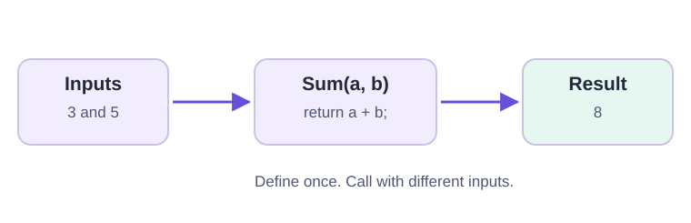
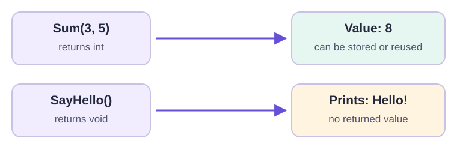
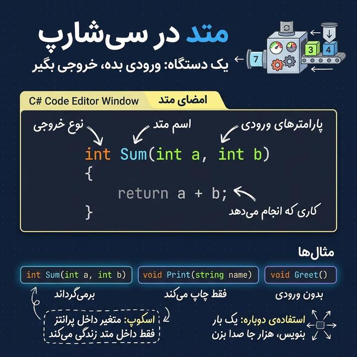
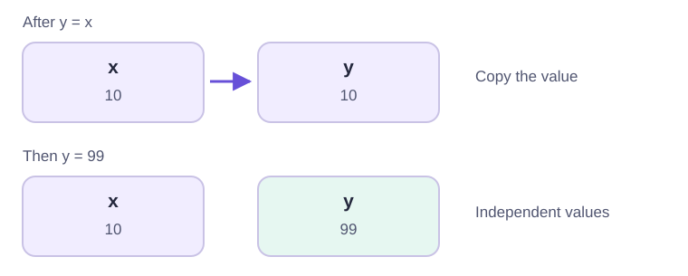
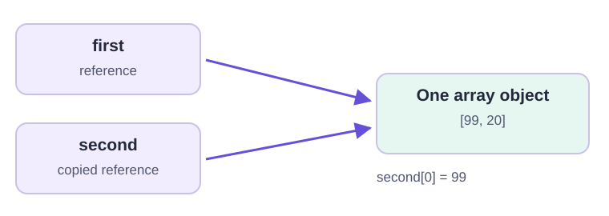
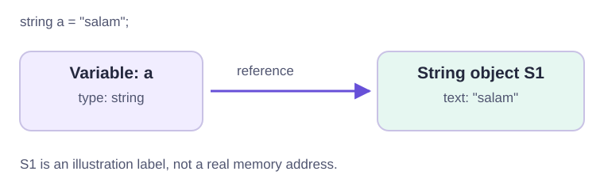
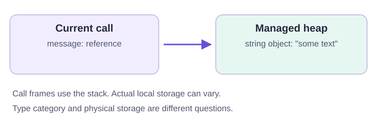

# جلسهٔ چهارم · یک بار بنویس، چند بار استفاده کن

<div class="lesson-intro">تاریخ برگزاری: <bdi dir="ltr">1405/08/05</bdi><br>با متدها به کدهای تکراری نام می‌دهیم؛ سپس می‌بینیم ورودی، خروجی، متغیر و حافظه چطور به هم مربوط می‌شوند.</div>

## هدف‌های جلسه و روش مطالعه

در پایان این جلسه باید بتوانی یک کار کوچک را به متد تبدیل کنی، ورودی و خروجی آن را مشخص کنی، محدودهٔ متغیرها را بشناسی و تفاوت کپی مقدار و کپی ارجاع را توضیح بدهی.

پیش‌نیاز این درس، متغیرها، شرط‌ها، حلقه‌ها، آرایه و کار با متن از سه جلسهٔ قبل است. بخش متدها را اول بخوان و مثال‌ها را اجرا کن؛ سپس سراغ نوع‌ها و مدل حافظه برو. هدفِ بخش حافظه، ساختن یک تصویر ذهنی درست است، نه حفظ جزئیات اجرای دات‌نت.

**اجرای مثال‌ها:** هر کادر `csharp` یک برنامهٔ مستقل است؛ آن را جداگانه در `Program.cs` پروژهٔ Console با top-level statements اجرا کن. نیازی به نوشتن کلاس یا `Main` نیست. تابع‌هایی که در این شکل داخل برنامه تعریف می‌کنیم از نظر فنی **تابع محلی یا local function** هستند؛ در این درس برای تمرین مفهوم متد از همین شکل استفاده می‌کنیم. آن‌ها خودکار از فایل‌ها و برنامه‌های دیگر قابل فراخوانی نیستند.

متن اصلی جزوه فارسی است. نمودارهای خطی برچسب و توضیح انگلیسی دارند تا جهت پیکان‌ها و اصطلاحات فنی روشن بماند؛ دو تصویر مرور درس، توضیح فارسی هم دارند. همهٔ تصویرها مدل آموزشی‌اند؛ اندازه یا جایگاه واقعی حافظه را نشان نمی‌دهند.

## ۱. متد چیست و چرا به آن نیاز داریم؟

متد را مثل یک دستگاه در نظر بگیر: ورودی می‌گیرد، کار مشخصی انجام می‌دهد و ممکن است نتیجه‌ای تحویل بدهد. دستگاه جمع، دو عدد می‌گیرد و جمعشان را می‌دهد؛ دستگاه خوشامدگویی، نام می‌گیرد و پیامی چاپ می‌کند.

<figure class="lesson-diagram">
  
  <figcaption lang="en" dir="ltr">Two inputs enter the method. The method calculates a result and returns it to the caller.</figcaption>
</figure>

### مسئلهٔ تکرار کد؛ اعتبارسنجی شمارهٔ موبایل

فرض کن برای بررسی شمارهٔ موبایل ۲۰ خط کد نوشته‌ایم و در ۱۰ جای برنامه به آن نیاز داریم. اگر در هر محل همان کد را کپی کنیم، حدود ۲۰۰ خط کد تکراری خواهیم داشت. حالا اگر متوجه اشتباه شویم یا قانون پذیرش شماره عوض شود، باید هر ۱۰ نسخه را پیدا و اصلاح کنیم. جا افتادن فقط یک نسخه یعنی رفتار بخش‌های برنامه با هم فرق می‌کند.

با متد، منطق بررسی را **یک بار** با یک نام مثل `IsValidMobile` می‌نویسیم و در هر محل فقط آن را فراخوانی می‌کنیم. بعداً قانون را در همان یک محل اصلاح می‌کنیم؛ همهٔ فراخوانی‌ها از همان منطق استفاده می‌کنند.

| بدون متد | با متد |
| --- | --- |
| منطق اعتبارسنجی در ۱۰ محل تکرار می‌شود | منطق یک بار تعریف می‌شود و ۱۰ بار فراخوانی می‌شود |
| تغییر قانون نیاز به اصلاح چند نسخه دارد | تغییر در تعریف متد انجام می‌شود |
| خواننده باید جزئیات چند خط را دوباره بررسی کند | نام متد، هدف کار را بیان می‌کند |

این ویژگی **استفادهٔ مجدد از کد یا code reusability** است. هر بار اجرای متد می‌تواند ورودی متفاوتی داشته باشد؛ استفادهٔ مجدد به معنی استفاده از یک نتیجهٔ ثابت نیست.

## ۲. تعریف متد؛ از ورودی تا خروجی

### اولین متد دارای نتیجه

```csharp
int Sum(int a, int b)
{
    int result = a + b;
    return result;
}

int total = Sum(3, 5);
Console.WriteLine(total);       // 8
Console.WriteLine(Sum(10, 2));  // 12
```

قسمت‌های تعریف را از چپ به راست بخوان:

| قسمت | نقش |
| --- | --- |
| `int` قبل از نام | نوع نتیجهٔ برگشتی؛ این متد عدد صحیح می‌دهد |
| `Sum` | نام متد؛ نام روشن، هدف آن را نشان می‌دهد |
| `(int a, int b)` | دو پارامتر ورودی با نوع و نام |
| `{ ... }` | بدنه؛ دستورهایی که با فراخوانی اجرا می‌شوند |
| `return result;` | پایان این اجرای متد و تحویل مقدار به محل فراخوانی |
| `Sum(3, 5)` | فراخوانی با دو آرگومان واقعی |

برای نام متدهای این درس از قرارداد `PascalCase` استفاده می‌کنیم؛ مثل `Sum`، `IsEven` و `CalculateArea`. این قرارداد خوانایی است. نام پارامترها و متغیرهای محلی همچنان `camelCase` است.

### تعریف با فراخوانی فرق دارد

تعریف متد یعنی شرح کار دستگاه؛ نوشتن بدنه به‌تنهایی آن را اجرا نمی‌کند. هر بار که `Sum(...)` را فراخوانی می‌کنیم، کنترل وارد بدنه می‌شود و با `return` به همان محل برمی‌گردد.

در `int total = Sum(3, 5);` این اتفاق‌ها می‌افتد:

1. مقدار ۳ در پارامتر `a` و مقدار ۵ در پارامتر `b` قرار می‌گیرد.
2. بدنه اجرا و مقدار ۸ محاسبه می‌شود.
3. `return` مقدار ۸ را تحویل می‌دهد.
4. مقدار برگشتی در `total` قرار می‌گیرد؛ سپس دستور چاپ اجرا می‌شود.

نوع نتیجه باید با مقدار برگشتی سازگار باشد. مثلاً متدی با نتیجهٔ `int` نمی‌تواند متن `"hello"` برگرداند. در متد دارای نتیجه، هر مسیری که به‌طور عادی تمام می‌شود باید نتیجه‌ای برگرداند. `return` چاپ نمی‌کند؛ اگر خروجی روی کنسول می‌خواهیم، باید آن را چاپ کنیم.

### متد بدون نتیجه با void

بعضی کارها فقط عملی انجام می‌دهند، مثلاً چاپ یک پیام:

```csharp
void SayHello()
{
    Console.WriteLine("Hello!");
}

SayHello();
SayHello();
```

خروجی:

```text
Hello!
Hello!
```

`void` یعنی متد **مقدار برگشتی ندارد**؛ نه اینکه هیچ کاری انجام نمی‌دهد. پرانتز خالی یعنی در این مثال پارامتری نداریم. فراخوانی همچنان به پرانتز نیاز دارد.

نمی‌توانیم نتیجهٔ `SayHello()` را در `int` یا `string` بریزیم؛ نتیجه‌ای برای ذخیره کردن ندارد. لازم نیست در پایان این بدنه `return` بنویسیم. در یک متد `void` می‌توان از `return;` بدون مقدار برای پایان زودتر استفاده کرد، ولی مثال‌های سادهٔ ما به آن نیاز ندارند.

<figure class="lesson-diagram">
  
  <figcaption lang="en" dir="ltr">A returned value can be stored or used in another calculation. A void method performs an action without returning a value.</figcaption>
</figure>

### مرور تصویری · اجزای یک متد

<figure class="lesson-illustration">
  
  <figcaption>تصویر مرور متد: ورودی‌ها، کار داخل بدنه و نتیجه را جدا از هم بخوان. <a href="../assets/images/session-04/methods-overview.jpg">مشاهدهٔ تصویر در اندازهٔ اصلی</a></figcaption>
</figure>

در نمونهٔ `Sum`، دو ورودی عددی داریم و مقدار جمع با `return` تحویل داده می‌شود. در نمونهٔ `Print`، ورودی `name` برای انجام کاری مثل چاپ استفاده می‌شود ولی مقدار برگشتی نداریم. نمونهٔ `Greet()` ورودی ندارد و می‌تواند پیام ثابت چاپ کند. عبارت «بدون ورودی» فقط به خالی بودن فهرست پارامترها اشاره می‌کند؛ `void` جداگانه می‌گوید نتیجه‌ای برنمی‌گردد.

جملهٔ scope در تصویر، متغیر و پارامتر داخل تابع را یادآوری می‌کند: نام آن‌ها بیرون بدنه قابل استفاده نیست. این جمله به معنی ناتوانی همهٔ تابع‌ها در خواندن دادهٔ بیرونی نیست؛ رفتار تابع محلیِ top-level را در بخش محدوده با مثال بررسی می‌کنیم. همچنین فقط تعریفِ متد، کار دستگاه را اجرا نمی‌کند؛ برای اجرا باید آن را صدا بزنیم.

### چاپ کردن یا برگرداندن؟

```csharp
void PrintSum(int a, int b)
{
    Console.WriteLine(a + b);
}

int Sum(int a, int b)
{
    return a + b;
}

PrintSum(2, 4);           // Prints 6
int result = Sum(2, 4);
Console.WriteLine(result * 2); // 12
```

`PrintSum` برای نمایش فوری مناسب است. `Sum` نتیجه را تحویل می‌دهد، پس می‌توانیم آن را چاپ کنیم، در متغیر نگه داریم یا وارد محاسبهٔ دیگری کنیم. اگر منطق محاسبه را از نمایش جدا کنیم، در جاهای بیشتری قابل استفاده خواهد بود.

## ۳. پارامتر، آرگومان و مقدار پیش‌فرض

پارامتر نام ورودی در **تعریف** است؛ آرگومان مقدار یا عبارتی است که در **فراخوانی** ارسال می‌کنیم.

```csharp
void Welcome(string name, int lessonNumber)
{
    Console.WriteLine($"Welcome, {name}! Lesson {lessonNumber}.");
}

Welcome("Sara", 4);

string studentName = "Ali";
Welcome(studentName, 4);
```

| در تعریف | در اولین فراخوانی | در دومین فراخوانی |
| --- | --- | --- |
| `name` | مقدار `"Sara"` | مقدار متغیر `studentName`، یعنی `"Ali"` |
| `lessonNumber` | مقدار `4` | مقدار `4` |

نام متغیرِ محل فراخوانی لازم نیست با نام پارامتر یکی باشد. ترتیب و نوع آرگومان‌ها باید با ورودی‌های تعریف‌شده سازگار باشند؛ در این مثال اول نام و بعد شمارهٔ جلسه را می‌فرستیم. نوشتن `Welcome(4, "Sara")` صحیح نیست.

### پارامتر با مقدار پیش‌فرض

اگر یک ورودی اغلب مقدار مشخصی دارد، می‌توانیم آن را در تعریف تعیین کنیم:

```csharp
void Welcome(string name, string course = "C# Bootcamp")
{
    Console.WriteLine($"Welcome, {name}! Course: {course}");
}

Welcome("Sara");
Welcome("Ali", "SQL Basics");
```

خروجی:

```text
Welcome, Sara! Course: C# Bootcamp
Welcome, Ali! Course: SQL Basics
```

در فراخوانی اول، آرگومان دوم را نفرستاده‌ایم؛ بنابراین مقدار پیش‌فرض `course` استفاده می‌شود. در فراخوانی دوم مقدار ارسال‌شده جای پیش‌فرض را می‌گیرد. پارامتر اجباری را قبل از پارامترهای اختیاری قرار بده. فعلاً از مقدارهای ثابت ساده مثل متن یا عدد برای پیش‌فرض استفاده کن.

اگر خودت متن خالی بفرستی، مقدار همان متن خالی است؛ پیش‌فرض فقط وقتی به کار می‌رود که آرگومان را **حذف** کنی، نه وقتی مقدار دلخواهی مثل `""` بدهی.

**تمرین کوتاه:** به متد خوشامدگویی یک ورودی اختیاری برای نام شهر اضافه کن. یک بار بدون شهر و یک بار با شهر دلخواه فراخوانی کن.

## ۴. محدودهٔ دسترسی؛ هر نام کجا قابل استفاده است؟

Scope یعنی محدوده‌ای از کد که یک نام در آن قابل استفاده است. آکولادها به ما کمک می‌کنند این محدوده‌ها را ببینیم. وجود یک متغیر در حافظه و قابل دسترس بودن نام آن، دقیقاً یک مفهوم نیستند؛ فعلاً روی محل استفادهٔ نام تمرکز می‌کنیم.

### متغیر و پارامتر داخل متد

```csharp
int DoubleNumber(int number)
{
    int doubled = number * 2;
    return doubled;
}

int answer = DoubleNumber(6);
Console.WriteLine(answer); // 12
// Console.WriteLine(doubled); // Invalid: outside the function body
// Console.WriteLine(number);  // Invalid: parameter is local to the function
```

نام‌های `number` و `doubled` بیرون از این تابع قابل استفاده نیستند. `return` خودِ متغیر محلی را به بیرون منتقل نمی‌کند؛ نتیجه را تحویل می‌دهد و ما آن را در متغیر دیگری به نام `answer` دریافت می‌کنیم.

### دو متد، دو متغیر مستقل

```csharp
void ShowFirstScore()
{
    int score = 10;
    Console.WriteLine(score);
}

void ShowSecondScore()
{
    int score = 20;
    Console.WriteLine(score);
}

ShowFirstScore();  // 10
ShowSecondScore(); // 20
```

با اینکه نام هر دو متغیر `score` است، در دو بدنهٔ جدا قرار دارند؛ تغییر یکی به معنی تغییر دیگری نیست. هر فراخوانی هم اجرای تازه‌ای با پارامترها و متغیرهای محلی خودش دارد.

### محدودهٔ یک بلوک داخل تابع

```csharp
void CheckScore(int score)
{
    if (score >= 10)
    {
        string message = "Passed";
        Console.WriteLine(message);
    }

    // Console.WriteLine(message); // Invalid: outside the if block
}

CheckScore(12);
```

`message` فقط داخل بلوک `if` قابل استفاده است. اگر نتیجه را بعد از شرط لازم داری، متغیر را در بلوک بیرونی تعریف و به‌درستی مقداردهی کن. همین اصل را برای متغیرِ تعریف‌شده داخل بدنهٔ حلقه هم در نظر بگیر.

### نکتهٔ مهم دربارهٔ top-level statements

در این شکل برنامه، تابع محلی می‌تواند به بعضی متغیرهای محدودهٔ بیرونیِ قابل دسترس هم رجوع کند. پس این جمله که «هیچ تابعی نمی‌تواند متغیر بیرون خودش را ببیند» درست نیست:

```csharp
string courseName = "C# Bootcamp";

void ShowCourse()
{
    Console.WriteLine(courseName);
}

ShowCourse(); // C# Bootcamp
```

در این مثال، `courseName` قبل از فراخوانی مقدار دارد و تابع محلی آن را از محدودهٔ بیرونی می‌خواند. با این حال برای منطق قابل استفادهٔ مجدد، معمولاً بهتر است دادهٔ لازم را با پارامتر بفرستیم؛ آن وقت وابستگی‌ها از روی ورودی‌های تابع مشخص‌اند. این رفتار را فعلاً به تابع‌های محلی همین درس محدود کن؛ قرار نیست همهٔ انواع متدها به هر متغیری در برنامه دسترسی داشته باشند.

### محدودهٔ خود تابع

```csharp
if (true)
{
    void ShowNote()
    {
        Console.WriteLine("Practice one example.");
    }

    ShowNote();
}

// ShowNote(); // Invalid: outside the block where the function is defined
```

تابع محلی داخل این بلوک از بیرون بلوک قابل فراخوانی نیست. تابع‌هایی که در سطح اصلی `Program.cs` تعریف کردیم در همان محدودهٔ برنامه قابل فراخوانی‌اند؛ تابعِ تعریف‌شده داخل بلوک کوچک‌تر محدودتر است. همچنین فراخوانی یک تابع محلی می‌تواند در متن کد قبل از تعریف آن نوشته شود؛ نوشتن تعریف، خودش اجرای بدنه نیست. برای خوانایی، در مثال‌های این درس تعریف را معمولاً قبل از فراخوانی می‌آوریم.

## ۵. تمرین استفادهٔ مجدد در چند مسئله

به جای حفظ شکل تعریف، هر بار از خودت بپرس: **چه می‌گیرم؟ چه می‌کنم؟ چه تحویل می‌دهم؟**

| مسئله | ورودی | کار | نتیجه |
| --- | --- | --- | --- |
| جمع | دو `int` | جمع دو عدد | `int` |
| زوج بودن | یک `int` | بررسی باقی‌ماندهٔ تقسیم بر ۲ | `bool` |
| مساحت مستطیل | طول و عرض از نوع `double` | ضرب طول در عرض | `double` |
| تبدیل دما | دمای سلسیوس از نوع `double` | اعمال فرمول تبدیل | `double` |
| اعتبارسنجی موبایل | یک `string` | بررسی پیش‌شماره، طول و رقم‌ها | `bool` |
| خوشامدگویی | نام از نوع `string` | نمایش پیام | بدون مقدار برگشتی، یعنی `void` |

### زوج بودن؛ نتیجهٔ منطقی هم یک خروجی است

```csharp
bool IsEven(int number)
{
    return number % 2 == 0;
}

Console.WriteLine(IsEven(8));  // True
Console.WriteLine(IsEven(7));  // False
Console.WriteLine(IsEven(0));  // True
Console.WriteLine(IsEven(-4)); // True

if (IsEven(12))
{
    Console.WriteLine("Even number");
}
```

عبارت مقایسهٔ `number % 2 == 0` خودش یک `bool` تولید می‌کند، پس می‌توانیم همان را برگردانیم. نام `IsEven` به خواننده می‌گوید نتیجه، پاسخ یک سؤال بله/خیر است.

### مساحت و تبدیل دما؛ فرمول را یک بار بنویس

```csharp
double CalculateRectangleArea(double length, double width)
{
    return length * width;
}

double CelsiusToFahrenheit(double celsius)
{
    return celsius * 9.0 / 5.0 + 32;
}

Console.WriteLine(CalculateRectangleArea(3, 4)); // 12
Console.WriteLine(CalculateRectangleArea(2.5, 2)); // 5
Console.WriteLine(CelsiusToFahrenheit(0));   // 32
Console.WriteLine(CelsiusToFahrenheit(100)); // 212
```

در این تمرین طول و عرض را غیرمنفی فرض می‌کنیم. متد مساحت فعلاً فقط فرمول را پیاده می‌کند؛ اگر مسئله محدودیت دیگری داشته باشد باید قانونش را جدا مشخص کنیم. در فرمول دما از `9.0` و `5.0` استفاده کرده‌ایم تا گرفتار تقسیم صحیح `9 / 5` نشویم.

مزیت `return` این است که خروجی فقط مخصوص چاپ نیست؛ مثلاً می‌توانیم مساحت دو اتاق را جدا حساب کنیم و نتیجه‌ها را جمع بزنیم.

### تبدیل منطق موبایل جلسهٔ سوم به متد

قانون همان است: فقط قالب‌های `09124567788`، `9124567788`، `989124567788`، `+989124567788` و `00989124567788` و شماره‌های هم‌شکل آن‌ها پذیرفته می‌شوند. بعد از بخش اختیاری پیش‌شماره، باید ۱۰ رقم انگلیسی با شروع `9` داشته باشیم. فاصله، خط تیره و رقم فارسی پذیرفته نیست. این بررسی قالب است، نه فعال بودن یا مالکیت شماره.

```csharp
bool IsValidMobile(string phone)
{
    string nationalNumber = "";

    if (phone.Length == 10)
    {
        nationalNumber = phone;
    }
    else if (phone.Length == 11 && phone.IndexOf('0') == 0)
    {
        nationalNumber = phone.Substring(1);
    }
    else if (phone.Length == 12 && phone.IndexOf("98") == 0)
    {
        nationalNumber = phone.Substring(2);
    }
    else if (phone.Length == 13 && phone.IndexOf("+98") == 0)
    {
        nationalNumber = phone.Substring(3);
    }
    else if (phone.Length == 14 && phone.IndexOf("0098") == 0)
    {
        nationalNumber = phone.Substring(4);
    }

    if (nationalNumber.Length != 10 || nationalNumber.IndexOf('9') != 0)
    {
        return false;
    }

    foreach (char digit in nationalNumber)
    {
        if (digit < '0' || digit > '9')
        {
            return false;
        }
    }

    return true;
}

string[] phones =
{
    "09124567788",
    "9124567788",
    "989124567788",
    "+989124567788",
    "00989124567788",
    "0912-4567788"
};

foreach (string phone in phones)
{
    Console.WriteLine($"{phone}: {IsValidMobile(phone)}");
}

Console.Write("Enter another mobile number: ");
string userPhone = Console.ReadLine() ?? "";

if (IsValidMobile(userPhone))
{
    Console.WriteLine("Valid mobile number");
}
else
{
    Console.WriteLine("Invalid mobile number");
}
```

برای پنج عضو اول آرایه، `True` و برای عضو آخر، `False` چاپ می‌شود. همان متد را هم در حلقه و هم برای ورودی کاربر استفاده کرده‌ایم. بدنهٔ اعتبارسنجی در هر دو محل کپی نشده است.

اینجا `return false;` هم نتیجه می‌دهد و هم **همان اجرای تابع** را فوری تمام می‌کند؛ به فراخواننده برمی‌گردیم و بقیهٔ بدنه اجرا نمی‌شود. `return` با `break` فرق دارد: `break` از حلقه یا `switch` بیرون می‌رود، ولی `return` از خود تابع خارج می‌شود. اگر هیچ بررسی‌ای شکست نخورد، در پایان `true` برمی‌گردد.

ورودی این متد طبق مثال، رشتهٔ غیرتهی از نظر ارجاع است؛ ممکن است متن خالی باشد که رد می‌شود. هنگام خواندن کنسول، همان `?? ""` آشنای جلسهٔ قبل را به کار برده‌ایم. رسیدگی به ارجاع تهی خارج از قرارداد این مثال را به مباحث بعد می‌سپاریم.

**تمرین کوتاه:** بدون دست زدن به بدنهٔ `IsValidMobile`، آن را برای چند شمارهٔ دیگر صدا بزن و تعداد شماره‌های معتبر را بشمار. منطق اعتبارسنجی باید فقط در یک محل بماند.

## ۶. var؛ نوع مشخص با نام‌نویسی کوتاه‌تر

با `var` از کامپایلر می‌خواهیم نوع متغیر محلی را از عبارت مقداردهی اولیه تشخیص بدهد. نوع هنگام کامپایل مشخص می‌شود؛ در طول برنامه آزادانه تغییر نمی‌کند.

```csharp
var age = 25;          // int
var price = 19.99;     // double
var message = "Hello"; // string
var temperature = 23.5F; // float

age = 26;
message = "Welcome";

Console.WriteLine(age);         // 26
Console.WriteLine(price);       // 19.99 (display depends on regional settings)
Console.WriteLine(message);     // Welcome
Console.WriteLine(temperature); // 23.5 (display depends on regional settings)

// age = "twenty-six"; // Invalid: age is still int
// var score;          // Invalid: no initial value to infer a type from
```

| تعریف با var | تعریف هم‌معنی در این مثال |
| --- | --- |
| `var age = 25;` | `int age = 25;` |
| `var price = 19.99;` | `double price = 19.99;` |
| `var message = "Hello";` | `string message = "Hello";` |
| `var temperature = 23.5F;` | `float temperature = 23.5F;` |

عدد اعشاری بدون پسوند در این مثال `double` است؛ وجود `F` در مثال آخر، نوع `float` را مشخص می‌کند. `var` نوع تازه‌ای نیست و به معنی «هر نوع دلخواه» نیست. همچنین باعث نمی‌شود همهٔ متغیرها reference type شوند یا محل حافظه‌شان عوض شود.

در این درس، پارامتر و نوع نتیجه را صریح می‌نویسیم؛ `var` را جای نوع پارامتر یا خروجی متدهای بالا قرار نده. هر جا نوشتن نوع به فهم مثال کمک می‌کند، مثل `int score`، همان شکل صریح انتخاب خوبی است.

## ۷. Value type؛ وقتی خود مقدار کپی می‌شود

`int`، `double` و `float` **نمونه‌هایی از value type هستند که تا اینجا با آن‌ها آشنا شده‌ایم**؛ value typeها فقط این سه نوع نیستند. نوع‌هایی مثل `bool`، `char`، `decimal`، `byte`، `short` و `long` که در جلسهٔ اول دیده‌ایم هم value type هستند. در ادامهٔ دوره با نمونه‌های دیگری هم آشنا می‌شویم؛ فعلاً قرار نیست فهرست کامل را حفظ کنیم. در مدل سادهٔ ما، متغیرِ این نوع‌ها خودِ مقدار را نگه می‌دارد. در انتساب معمولی به متغیر دیگر، یک کپی مستقل از آن مقدار می‌گیریم.

```csharp
int x = 10;
int y = 20;
y = x;

Console.WriteLine(x); // 10
Console.WriteLine(y); // 10

y = 99;
Console.WriteLine(x); // 10
Console.WriteLine(y); // 99
```

رد اجرای برنامه:

| مرحله | x | y | توضیح |
| --- | --- | --- | --- |
| تعریف اولیه | ۱۰ | ۲۰ | دو محل نام‌دار با دو مقدار |
| بعد از `y = x` | ۱۰ | ۱۰ | مقدار x کپی و جای مقدار قبلی y گذاشته شده |
| بعد از `y = 99` | ۱۰ | ۹۹ | تغییر y، مقدار x را تغییر نمی‌دهد |

<figure class="lesson-diagram">
  
  <figcaption lang="en" dir="ltr">Assignment copies the value. The two variables can change independently afterward.</figcaption>
</figure>

اگر بخواهی برای متغیرها آدرس خیالی تصور کنی، x و y را دو خانهٔ برچسب‌دار جدا ببین؛ نیازی به دانستن عدد آدرس نیست. خانه‌های شکل فقط بیانِ استقلال مقدارها هستند و محل فیزیکی واقعی حافظه را تعیین نمی‌کنند.

### ارسال عدد به متد هم در این مثال کپی است

```csharp
void ChangeNumber(int number)
{
    number = 99;
    Console.WriteLine(number);
}

int original = 10;
ChangeNumber(original);       // 99
Console.WriteLine(original);  // 10
```

پارامتر `number` با کپی مقدار `original` شروع می‌شود. عوض کردن آن، `original` را عوض نمی‌کند. اگر مقدار محاسبه‌شده را برای بیرون می‌خواهیم، یک راه روشن، برگرداندن نتیجه با `return` و ذخیرهٔ آن در متغیر مقصد است.

## ۸. Reference type؛ متغیر و دادهٔ مورد اشاره

در یک **reference type (رفرنس تایپ)**، متغیر یک **ارجاع به شیء** را نگه می‌دارد. شیء همان دادهٔ جداگانه‌ای است که ارجاع به آن اشاره می‌کند؛ فعلاً برای دیدن این مفهوم، آرایه و متن که قبلاً استفاده کرده‌ایم کافی‌اند.

در انتساب معمولی، **خودِ ارجاع کپی می‌شود**؛ یک شیء تازه همراه با کپی کامل داده‌ها ساخته نمی‌شود. دو متغیر می‌توانند به همان داده اشاره کنند.

### آرایه؛ دیدن اثر ارجاع مشترک

```csharp
int[] first = { 10, 20 };
int[] second = first;

second[0] = 99;

Console.WriteLine(first[0]);  // 99
Console.WriteLine(second[0]); // 99
```

آرایه reference type است، با اینکه عضوهای این آرایه از value type `int` هستند. پس `second = first` کل آرایه را کپی نمی‌کند. هر دو متغیر به یک آرایه اشاره می‌کنند؛ تغییر عضو آن آرایه از هر مسیر، در مسیر دیگر هم دیده می‌شود.

<figure class="lesson-diagram">
  
  <figcaption lang="en" dir="ltr">The reference is copied, not the array. Both variables refer to the same object.</figcaption>
</figure>

همین اصل را برای ورودی معمولیِ متد هم در نظر بگیر: اگر آرایه را به متد بفرستی، کپیِ ارجاع به همان آرایه ارسال می‌شود، نه یک آرایهٔ مستقل. تغییر عضوها با آن ارجاع می‌تواند در بیرون دیده شود. جزئیات روش‌های دیگر ارسال ورودی را فعلاً لازم نداریم.

| پرسش | مقدار مثل int | ارجاع مثل آرایه |
| --- | --- | --- |
| متغیر چه دارد؟ | خود مقدار عدد | ارجاع به یک شیء آرایه |
| در انتساب معمولی چه چیزی کپی می‌شود؟ | مقدار عدد | مقدار ارجاع |
| آیا یک نسخهٔ مستقل از دادهٔ هدف ساخته می‌شود؟ | مقدار عدد مستقل است | نه؛ آرایه همچنان مشترک است |
| آیا تغییر دادهٔ مشترک دیده می‌شود؟ | متغیر عددی دیگر مستقل است | تغییر عضو آرایه از هر دو ارجاع دیده می‌شود |

این جدول دربارهٔ رفتار کپی و تغییر است، نه دربارهٔ stack یا heap. همچنین «ارجاع» در این درس یعنی reference به شیء؛ نیازی به نوشتن یا حساب کردن آدرس حافظه نیست.

### مرور تصویری · کپی مقدار یا کپی reference؟

<figure class="lesson-illustration">
  
  <figcaption>برای خواندن تصویر، اول مشخص کن چه چیزی کپی شده: خود مقدار یا reference به دادهٔ مشترک. <a href="../assets/images/session-04/value-reference-types.jpg">مشاهدهٔ تصویر در اندازهٔ اصلی</a></figcaption>
</figure>

**سمت راست تصویر:** بعد از انتساب عدد ۲۵ از `x` به `y`، دو مقدار مستقل داریم. تغییر مقدار یکی، دیگری را تغییر نمی‌دهد. `int` مثال این سمت است؛ همان‌طور که گفتیم، تنها value type زبان نیست.

**سمت چپ تصویر:** دو متغیر، reference به یک شیء مشترک دارند. نمونهٔ آشنای ما همان آرایهٔ `first` و `second` است: تغییر عضو آرایه از یک مسیر، از مسیر دیگر هم دیده می‌شود. کلمهٔ `class` در تصویر فقط یک نمونه از خانوادهٔ reference typeهاست؛ تعریف کلاس را بعداً یاد می‌گیریم و برای فهم این درس، مثال آرایه کافی است. `string` و آرایه هم reference type هستند.

برای اینکه تصویر باعث برداشت نادرست نشود، این سه نکته را همراهش بخوان:

- «تغییر از یک طرف روی دیگری تأثیر می‌گذارد» دربارهٔ **تغییر دادهٔ همان شیء مشترکِ قابل تغییر** است. اگر به یکی از متغیرها یک شیء دیگر نسبت بدهیم، reference متغیر دیگر عوض نمی‌شود. عبارت «همیشه اشاره به همان یکی» در تصویر فقط وضعیت بعد از کپی reference و پیش از انتساب دوباره را توصیف می‌کند.
- این شکل، جای حافظه را ساده‌سازی کرده است. value type بودن مساوی «همیشه روی stack بودن» نیست؛ مثلاً عضوهای عددی یک آرایه، بخشی از دادهٔ همان آرایه‌اند. reference محلی هم بسته به زمینهٔ اجرا می‌تواند به شکل متفاوتی نگهداری شود. بخش Stack و Heap این تفاوت را دقیق‌تر توضیح می‌دهد.
- `0x101` یک آدرس **خیالی برای فهم رابطه** است؛ آدرس واقعی، ثابت یا قابل اتکایی برای برنامهٔ ما نیست. رشته‌ها هم با وجود reference type بودن، متنِ تغییرپذیر ندارند؛ رفتار `string` را در بخش بعد جدا بررسی می‌کنیم.

## ۹. باز کردن عبارت string a = "salam"

```csharp
string a = "salam";
Console.WriteLine(a); // salam
```

| بخش | معنی |
| --- | --- |
| `string` | نوع متغیر؛ یک reference type برای متن |
| `a` | نام متغیر |
| `"salam"` | مقدار متنی رشته که در این عبارت به یک شیء رشته مربوط می‌شود |
| `=` | قرار دادن ارجاع به آن شیء در متغیر a |

در مدل ذهنی ما، خانهٔ `a` تمام حرف‌های متن را مثل یک عدد صحیح داخل خودش نگه نمی‌دارد؛ یک reference به شیء رشته دارد و دادهٔ متن جداست. شیء رشته شامل اطلاعات متن است؛ فعلاً جزئیات داخلی آن را لازم نداریم.

<figure class="lesson-diagram">
  
  <figcaption lang="en" dir="ltr">string is the type, a is the variable name, and &quot;salam&quot; is the text. The variable refers to the string object.</figcaption>
</figure>

نام `S1` در نمودار فقط شناسهٔ آموزشی برای آن شیء است؛ آدرس واقعی یا نامی در کد سی‌شارپ نیست. از این انتساب نتیجه نگیر که هر بار نوشتن یک متن حتماً یک شیء جدید می‌سازد؛ دات‌نت می‌تواند متن‌های ثابت یکسان را به اشتراک بگذارد.

### چرا مقایسهٔ دو رشتهٔ برابر، True است؟

```csharp
string a = "ali";
string b = "ali";

Console.WriteLine(a == b); // True
```

با اینکه `string` reference type است، عملگر `==` برای رشته‌ها **محتوای متن** را مقایسه می‌کند. هر دو متن `ali` هستند، پس نتیجه `True` می‌شود. از «reference type بودن» نمی‌توان نتیجه گرفت که `==` همیشه فقط یکسان بودن ارجاع‌ها را بررسی می‌کند.

دو سؤال را از هم جدا کن:

| سؤال | موضوع |
| --- | --- |
| آیا این متغیر از value type است یا reference type؟ | رفتار نگهداری و کپی مقدار متغیر |
| عملگر `==` برای این نوع چه معنایی دارد؟ | قانون مقایسهٔ تعریف‌شده برای همان نوع |

ممکن است رشته‌های ثابت یکسان به یک شیء مشترک مربوط باشند؛ اما برای توضیح خروجی این برنامه نیازی به تکیه بر آن نداریم. حتی اگر دو شیء رشتهٔ جدا با متن برابر داشته باشیم، مقایسهٔ رشته‌ایِ `==` متنشان را برابر می‌داند. یکسان بودن متن و یکسان بودن خود شیء، دو پرسش متفاوت‌اند.

### چرا تغییر b، متن a را عوض نمی‌کند؟

```csharp
string a = "ali";
string b = a;
b = "reza";

Console.WriteLine(a);      // ali
Console.WriteLine(b);      // reza
Console.WriteLine(a == b); // False
```

بعد از `b = a` هر دو به همان رشته اشاره می‌کنند. اما `b = "reza"` **ارجاعِ داخل b را عوض می‌کند**، نه محتوای شیء قبلی را. `a` هنوز به رشتهٔ دارای متن `ali` اشاره دارد.

رشته‌ها در سی‌شارپ **تغییرناپذیر یا immutable** هستند؛ متنِ داخل یک شیء رشته بعد از ساخته شدن تغییر نمی‌کند. عملیات‌هایی مثل `ToUpper()` نتیجهٔ رشته‌ای برمی‌گردانند؛ اگر آن را به متغیر نسبت بدهیم، ارجاع متغیر به نتیجه تغییر می‌کند. این رفتار با تغییر عضو آرایه فرق دارد، چون آرایهٔ قبلی قابل تغییر بود.

پس دو ادعای نادرست را کنار بگذار: «string یک value type است چون == متن را مقایسه می‌کند» و «هر تغییر یک متغیر reference type باید همهٔ متغیرهای دیگر را عوض کند». باید ببینیم داریم **ارجاع متغیر** را عوض می‌کنیم یا **دادهٔ شیء مشترک** را.

## ۱۰. Stack و Heap؛ یک تصویر ساده، با مرزهای مشخص

برنامه برای اجرای دستورها و نگهداری داده‌ها از حافظه استفاده می‌کند. Stack و heap دو مفهوم مربوط به شیوهٔ اجرای برنامه و نگهداری داده‌ها هستند؛ value type و reference type دو دسته‌بندیِ نوع در زبان‌اند. این‌ها دو محور متفاوت‌اند.

### Stack؛ اطلاعات مربوط به اجرای فراخوانی‌ها

در مدل معمول اجرای برنامه، هر فراخوانی یک قاب اجرا یا **stack frame** دارد که اطلاعات لازم برای ادامهٔ اجرا و بعضی داده‌های موقت را نگه می‌دارد. ورود به یک فراخوانی را مثل گذاشتن یک قاب روی قاب قبلی و برگشت از آن را مثل برداشتن قاب بالایی تصور کن؛ آخرین قاب واردشده، اولین قاب خارج‌شده است.

وقتی `Sum(3, 5)` را اجرا می‌کنیم، یک اجرای مشخص از تابع داریم. هنگام برگشت، محاسبهٔ فراخواننده از همان محل ادامه پیدا می‌کند. این تصویر برای فهم رفت‌وبرگشت مفید است؛ لازم نیست تصور کنیم همهٔ پارامترها و متغیرها حتماً در خانه‌های جداگانهٔ stack نوشته می‌شوند.

### Heap؛ فضای نگهداری اشیای مدیریت‌شده

در مدل معمول دات‌نت، اشیایی مانند رشته و آرایه در **managed heap** قرار می‌گیرند و با ارجاع به آن‌ها دسترسی داریم. عمر شیء لزوماً با پایان یک فراخوانی تمام نمی‌شود؛ ممکن است هنوز از بخش دیگری قابل دسترس باشد.

مدیریت حافظهٔ اشیای دیگر موردنیازنبوده بر عهدهٔ **Garbage Collector یا GC** است. زمان دقیق جمع‌آوری را در این درس پیش‌بینی نمی‌کنیم و نمی‌گوییم با خروج از هر تابع، شیء فوراً پاک می‌شود.

### مثال رشته و محل داده

```csharp
string message = "some text";
Console.WriteLine(message);
```

<figure class="lesson-diagram">
  
  <figcaption lang="en" dir="ltr">Conceptual view: a local variable holds a reference to a string object. Real local storage may use a stack slot, a register, or other runtime-managed storage.</figcaption>
</figure>

در شکل، `message` را در بخش «اجرای فعلی» گذاشته‌ایم و شیء متن را جدا نشان داده‌ایم. این شکل می‌گوید **متغیر و شیء یک چیز نیستند**؛ تضمین نمی‌کند محل واقعیِ `message` در هر اجرای برنامه دقیقاً یک خانهٔ stack باشد. کامپایلر و محیط اجرا می‌توانند بعضی متغیرها را در ثبات پردازنده نگه دارند یا بعضی تخصیص‌ها و کپی‌ها را بهینه کنند.

### چرا «value type یعنی stack» درست نیست؟

| وضعیت | مدل مناسب برای فکر کردن |
| --- | --- |
| یک `int` محلی در یک فراخوانی ساده | یک مقدار مستقل؛ ممکن است در stack یا ثبات پردازنده نگه داشته شود یا بهینه شود |
| عضوهای `int` در آرایهٔ `int[]` | مقدار عددها بخشی از دادهٔ خود آرایه هستند؛ در مدل معمول، آرایه در heap است |
| یک فیلد عددی داخل یک شیء | می‌تواند همراه همان شیء در heap نگه داشته شود؛ لازم نیست فعلاً تعریف فیلد یا کلاس بنویسیم |
| یک متغیر محلی `string` | ارجاع به متن؛ محل نگهداری خودِ ارجاع وابسته به زمینهٔ اجراست |
| خود شیء رشته | در مدل معمول، دادهٔ جداگانه در managed heap |

آرایهٔ `int[]` را قبلاً ساخته‌ایم؛ همان مثال نشان می‌دهد یک `int` می‌تواند **داخل دادهٔ یک شیء در heap** باشد. از طرف دیگر، متغیری که ارجاع به یک شیء دارد لازم نیست خودش همان محل شیء را داشته باشد.

**نوع چه چیزی را مشخص می‌کند؟** `int` یا `string` صریح، یا نوعی که از `var` استنباط شده، قواعد مقدار، عملیات و کپی را هنگام کامپایل مشخص می‌کند. **جای داده را چه چیزی مشخص می‌کند؟** زمینهٔ استفاده، شکل داده و تصمیم‌های کامپایلر و زمان اجرا. فقط از روی نام نوع نمی‌توان جای دقیق تمام داده‌هایش را روی stack یا heap تعیین کرد.

این توضیح را با مدل scope ترکیب کن: پایان محدودهٔ یک نام، الزاماً به معنی پاک شدن فوری شیء مورد اشاره نیست. برای نوشتن مثال‌های این جلسه، شناخت رفتار کپی و ارجاع مهم‌تر از حدس زدن آدرس‌های حافظه است.

## ۱۱. کنار هم گذاشتن مفهوم‌ها

هنگام خواندن هر برنامه این پرسش‌ها را به‌ترتیب جواب بده:

1. متد چه ورودی و چه نتیجه‌ای دارد؟ آیا فقط عملی را انجام می‌دهد؟
2. در هر فراخوانی، کدام مقدارها به پارامترها داده می‌شوند؟
3. نام هر متغیر در کدام بلوک قابل استفاده است؟
4. نوع متغیر صریح نوشته شده یا از مقدار اولیه استنباط شده است؟
5. در انتساب، مقدار مستقل کپی شده یا ارجاع به دادهٔ مشترک؟
6. آیا داریم دادهٔ یک شیء قابل تغییر را عوض می‌کنیم یا ارجاع یک متغیر را؟

| برداشت نادرست | برداشت درست |
| --- | --- |
| تعریف متد یعنی اجرای آن | اجرا با فراخوانی آغاز می‌شود |
| return همان چاپ است | return نتیجه می‌دهد؛ چاپ یک عمل جداست |
| void هیچ کاری نمی‌کند | void مقدار برنمی‌گرداند، ولی می‌تواند کاری مثل چاپ انجام دهد |
| متغیر داخل متد را از بیرون می‌توان خواند | نام محلی محدود به محدودهٔ خودش است |
| var یعنی نوع متغیر آزاد است | نوع از ابتدا مشخص و ثابت است |
| در انتساب آرایه، همهٔ داده‌ها کپی می‌شوند | در انتساب معمولی، ارجاع کپی می‌شود |
| string یک reference type است، پس متن‌های برابر با == نابرابرند | == برای string محتوای متن را مقایسه می‌کند |
| همهٔ value typeها روی stack هستند | محل نگهداری به زمینهٔ استفاده هم بستگی دارد |

## ۱۲. تمرین و مرور

۱. **جمع قابل استفادهٔ مجدد:** `Sum` را برای `(3, 5)`، `(-2, 7)` و `(0, 0)` فراخوانی کن. انتظار: `8`، `5` و `0`. نتیجهٔ دو فراخوانی را در یک جمع جدید استفاده کن؛ محاسبه را داخل متد چاپ نکن.

۲. **خوشامدگویی:** متد `void` با ورودی نام و ورودی اختیاری نام دوره بساز. یک بار پیش‌فرض و یک بار نام دورهٔ دلخواه را استفاده کن. توضیح بده چرا نمی‌توانی نتیجهٔ آن را داخل `string` قرار بدهی.

۳. **زوج یا فرد:** با `IsEven` برای عددهای `{ -4, 0, 3, 8 }` نتیجه بگیر. انتظار: `True, True, False, True`. بدون کپی کردن شرط، از همان تابع در یک حلقه استفاده کن.

۴. **مساحت دو اتاق:** مساحت مستطیل‌های `(3, 4)` و `(2.5, 2)` را با متد به دست بیاور و مجموع را چاپ کن. انتظار: `17`. ورودی‌های طول و عرض غیرمنفی‌اند.

۵. **دما:** خروجی متد تبدیل دما برای `0`، `100` و `-40` باید به‌ترتیب `32`، `212` و `-40` باشد. توضیح بده اگر اول `9 / 5` را به صورت دو عدد صحیح حساب کنیم چه اشکالی پیش می‌آید.

۶. **اعتبارسنجی بدون تکرار:** پنج قالب معتبر موبایل جلسهٔ قبل، متن خالی، `0912-4567788`، `+9809124567788` و `۰۹۱۲۴۵۶۷۷۸۸` را در آرایه قرار بده. با یک حلقه و یک متد نتیجه‌ها را چاپ کن. فقط پنج قالب درست باید پذیرفته شوند؛ بدنهٔ اعتبارسنجی فقط یک بار تعریف شود.

۷. **محدوده را پیدا کن:** در مثال `DoubleNumber`، توضیح بده چرا `answer` بیرون قابل استفاده است اما `doubled` نیست. سپس یک متغیر داخل `if` تعریف کن و خطِ تلاش برای استفاده از آن در بیرون را فقط به صورت کامنت بنویس.

۸. **نوع‌های var:** بدون اجرا نوع `var count = 5;`، `var distance = 5.0;`، `var ratio = 5.0F;` و `var title = "5";` را بنویس. انتظار: `int`، `double`، `float` و `string`. آیا `title = 5` مجاز است؟ چرا؟

۹. **کپی مقدار:** جدول مقدارهای `x` و `y` را برای تعریف `x = 10` و `y = 20`، سپس `y = x` و بعد `x = 30` رسم کن. در پایان انتظار داریم x برابر ۳۰ و y برابر ۱۰ باشد.

۱۰. **کپی ارجاع:** در مثال آرایه، بعد از تغییر `second[0]`، به `second` یک آرایهٔ تازه با `new int[] { 5, 6 }` نسبت بده. آیا `first[0]` هنوز ۹۹ است؟ انتظار: بله؛ اکنون دو متغیر به دو آرایهٔ جدا اشاره می‌کنند. شکل قبل و بعد را روی کاغذ بکش.

۱۱. **رشته و برابری:** دو رشتهٔ `"ali"` تعریف کن، مقایسه را چاپ کن و سپس یکی را به `"reza"` نسبت بده. خروجی مقایسهٔ اول `True` و دومی `False` است. توضیح بده چه چیزی تغییر کرد و چرا reference type بودن string با مقایسهٔ متن تناقض ندارد.

۱۲. **مدل حافظه:** برای `string a = "salam";` یک خانه برای متغیر و یک کادر برای دادهٔ رشته بکش و با پیکان وصل کن. زیر شکل بنویس: «این مدل رابطهٔ متغیر و شیء را نشان می‌دهد، نه محل قطعی همهٔ متغیرها در حافظه.» سپس مثال آرایهٔ عددی را بیاور تا نشان بدهی value type بودن با stack بودن یکی نیست.

**معیار پایان جلسه:** بتوانی یک کار تکراری را به تابع محلی با ورودی و خروجی روشن تبدیل کنی و برای تفاوت کپی عدد، کپی ارجاع آرایه و انتساب دوبارهٔ رشته توضیح قابل فهمی بدهی.

## منابع مطالعه

برای مرور درس، موضوع‌های زیر از W3Schools مناسب‌اند؛ شکل مثال‌های آن سایت ممکن است با برنامهٔ top-level این جزوه فرق داشته باشد. مثال‌های همین صفحه را مبنای اجرای تمرین‌ها قرار بده:

- [W3Schools · متدها](https://www.w3schools.com/cs/cs_methods.php) و [پارامترهای متد](https://www.w3schools.com/cs/cs_method_parameters.php)
- [Microsoft Learn · توابع محلی و محدودهٔ آن‌ها](https://learn.microsoft.com/en-us/dotnet/csharp/programming-guide/classes-and-structs/local-functions)، [top-level statements](https://learn.microsoft.com/en-us/dotnet/csharp/fundamentals/program-structure/top-level-statements) و [پارامترهای اختیاری](https://learn.microsoft.com/en-us/dotnet/csharp/programming-guide/classes-and-structs/named-and-optional-arguments)
- [Microsoft Learn · var و تعریف متغیر محلی](https://learn.microsoft.com/en-us/dotnet/csharp/language-reference/statements/declarations#implicitly-typed-local-variables)
- [Microsoft Learn · value typeها](https://learn.microsoft.com/en-us/dotnet/csharp/language-reference/builtin-types/value-types)، [reference typeها](https://learn.microsoft.com/en-us/dotnet/csharp/language-reference/builtin-types/reference-types) و [رشته‌ها و تغییرناپذیری](https://learn.microsoft.com/en-us/dotnet/csharp/programming-guide/strings/)
- [Microsoft Learn · مبانی مدیریت حافظه](https://learn.microsoft.com/en-us/dotnet/standard/garbage-collection/fundamentals)؛ منبع تکمیلی برای مدرس یا مطالعهٔ بعدی است و جزئیات آن برای تمرین‌های امروز لازم نیست.

[→ جلسهٔ قبل: آرایه و پردازش متن](session-03.md) · [جلسهٔ بعد: مسیر حل مسئله و جست‌وجو ←](session-05.md)
