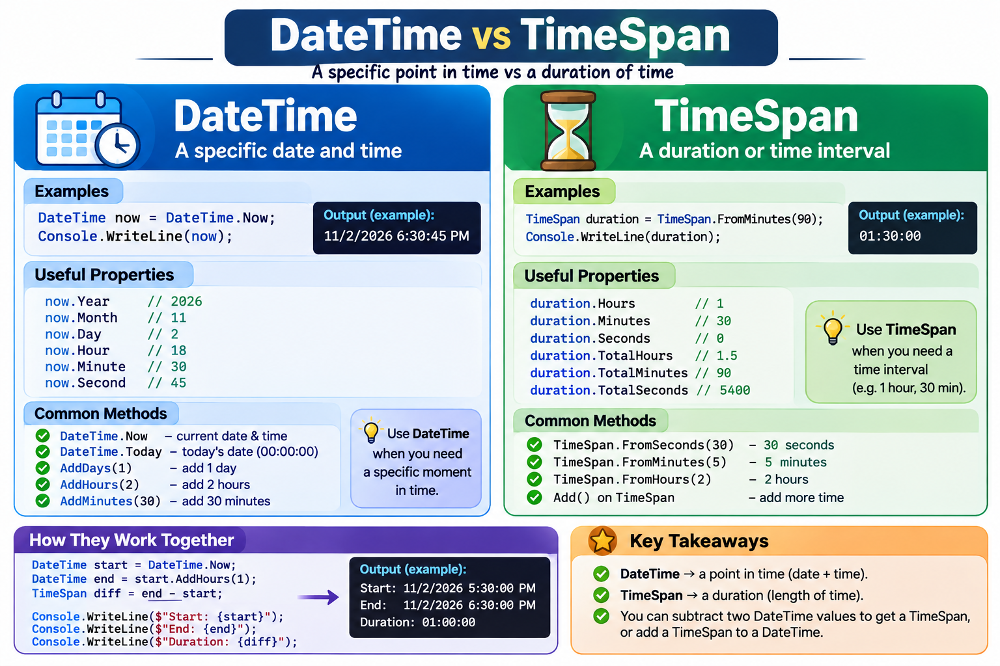
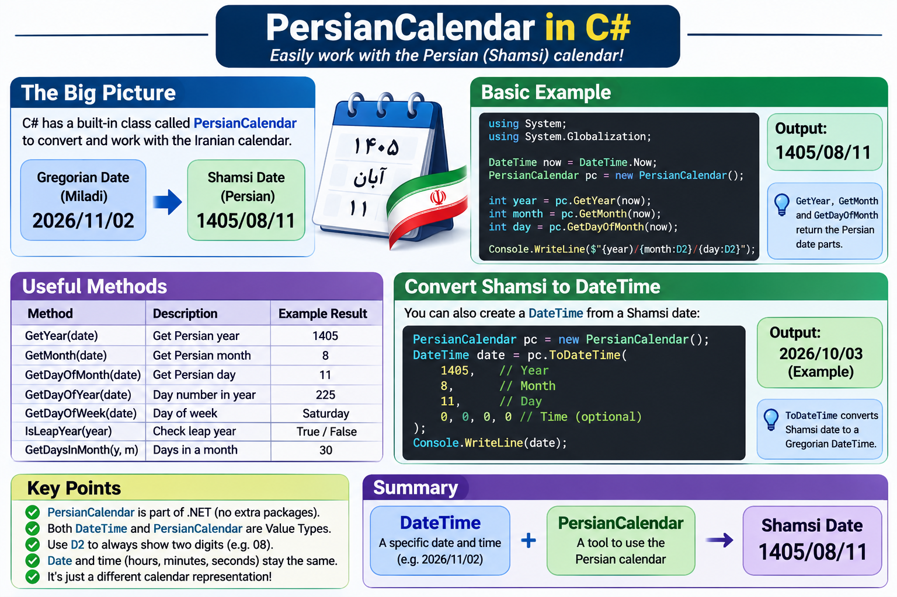

# جلسهٔ ششم · اول حرکت خانه‌ها را بفهم، بعد کد بزن

<div class="lesson-intro">تاریخ برگزاری: <bdi dir="ltr">1405/08/12</bdi><br>ادامهٔ مسیر حل مسئله با Bubble Sort، آشنایی قدم‌به‌قدم با Quick Sort، حذف از آرایه و ساخت دنبالهٔ فیبوناچی.</div>

## ۱. الگوریتم یعنی چه؟

الگوریتم یعنی یک روشِ مرحله‌به‌مرحله و روشن برای رسیدن از ورودی به جواب. این روش را باید بتوانیم قبل از سی‌شارپ، روی کاغذ اجرا کنیم. عبارت «اعداد را مرتب کن» هدف است؛ اما هنوز نگفته‌ایم **با کدام مقایسه و جابه‌جایی** به هدف می‌رسیم.

در این جلسه، خانه‌های آرایه را مثل کارت‌های شماره‌دار روی میز در نظر بگیر. اندیس، شمارهٔ خانه است؛ مقدار، عدد روی کارت داخل آن خانه. هنگام مرتب‌سازی، مقدارها جابه‌جا می‌شوند و شمارهٔ خانه‌ها همان می‌ماند.

```text
Index:    0     1     2     3
Array:  [ 5 ] [ 1 ] [ 4 ] [ 2 ]
Goal:   [ 1 ] [ 2 ] [ 4 ] [ 5 ]
```

قرارداد مرتب‌سازی این درس **صعودی** است: هر عضو از عضو بعدی بزرگ‌تر نباشد. تعداد عضوها و تعداد تکرار هر عدد باید حفظ شود؛ «مرتب شد» به معنی حذف عددهای تکراری نیست.

### برگهٔ حل مسئله را دوباره استفاده کن

قبل از هر کد این سؤال‌ها را جواب بده:

1. ورودی و خروجی چیست؟ آیا خود آرایه عوض می‌شود یا آرایهٔ تازه برمی‌گردد؟
2. با یک نمونهٔ کوچک، حرکت بعدی من چیست؟
3. چه چیزی باید حفظ شود؛ مثل تعداد اعداد یا ترتیب عضوهای باقی‌مانده؟
4. چه متغیرهایی لازم دارم و هرکدام چه نقشی دارند؟
5. چرا مراحل بالاخره تمام می‌شوند؟
6. کدام ورودی کوچک می‌تواند فکر اولیه‌ام را رد کند؟

**روش مطالعه:** هر برنامهٔ `csharp` را جداگانه در `Program.cs` پروژهٔ Console با top-level statements اجرا کن. تابع‌ها به شکل تابع محلی جلسهٔ چهارم نوشته شده‌اند. فقط از آرایه و ابزارهای آشنا استفاده می‌کنیم. بخش تاریخ و زمان در پایان، مطالعهٔ اضافه است و پیش‌نیاز الگوریتم‌ها نیست.

## ۲. Bubble Sort · مقایسهٔ دو همسایه

### ایده را بدون کد بساز

در آرایهٔ `{ 5, 1, 4, 2 }` اگر از چپ به راست، هر دو **همسایه** را مقایسه کنیم و عضو بزرگ‌تر را سمت راست بگذاریم، چه می‌شود؟

| مقایسه در دور اول | تصمیم | وضعیت آرایه |
| --- | --- | --- |
| ۵ و ۱ | جابه‌جا شوند | `{ 1, 5, 4, 2 }` |
| ۵ و ۴ | جابه‌جا شوند | `{ 1, 4, 5, 2 }` |
| ۵ و ۲ | جابه‌جا شوند | `{ 1, 4, 2, 5 }` |

حالا ۵ به آخر رسیده و در جای نهایی خود است. اما بقیه هنوز مرتب نیستند: ۴ قبل از ۲ مانده است. پس یک عبور کافی نیست.

در عبور دوم فقط بخشِ قبل از ۵ را بررسی می‌کنیم:

| مقایسه در دور دوم | تصمیم | وضعیت آرایه |
| --- | --- | --- |
| ۱ و ۴ | بدون تغییر | `{ 1, 4, 2, 5 }` |
| ۴ و ۲ | جابه‌جا شوند | `{ 1, 2, 4, 5 }` |

اکنون ۴ هم به جای نهایی‌اش رسیده است. در دور سوم فقط ۱ و ۲ مقایسه می‌شوند و آرایه تغییر نمی‌کند.

```text
Start:   [5, 1, 4, 2]
Pass 1:  [1, 4, 2 | 5]
Pass 2:  [1, 2 | 4, 5]
Pass 3:  [1 | 2, 4, 5]
```

خط عمودی فقط مرز آموزشی است؛ عضوهای سمت راست در پایان هر عبور در جای نهایی‌اند. ما آرایه را واقعاً به دو آرایه تبدیل نکرده‌ایم.

### چرا این فکر جواب می‌دهد؟

با مقایسهٔ همسایه‌ها، بزرگ‌ترین مقدارِ بخشِ هنوز نامرتب، قدم‌به‌قدم به انتهای آن بخش می‌رود. بعد از هر عبور کامل، یک عضو دیگر در انتها تثبیت می‌شود. برای آرایهٔ nعضوی، حداکثر n منهای یک عبورِ این نسخه کافی است؛ آخرین عضو باقی‌مانده هم خودبه‌خود در جای درست قرار دارد.

### قبل از حلقه‌ها، جابه‌جایی را بفهم

برای عوض کردن دو مقدار نمی‌توانیم مقدار اول را از بین ببریم. اگر فقط `left = right` و بعد `right = left` بنویسیم، هر دو مقدار برابر مقدار قبلی right می‌شوند.

```csharp
int left = 5;
int right = 1;

int temp = left;
left = right;
right = temp;

Console.WriteLine(left);  // 1
Console.WriteLine(right); // 5
```

`temp` همان محل موقتِ نگه‌داشتن کارت اول است تا وقتی جای آن را با کارت دوم پر می‌کنیم، مقدارش گم نشود. همین کار را برای دو خانهٔ آرایه انجام می‌دهیم.

### تبدیل الگوریتم به کد

دو تکرار داریم: یک حلقه برای عبورها و یک حلقه برای مقایسهٔ همسایه‌های هر عبور. حلقهٔ داخلی برای **همان عبور** کامل می‌شود، بعد حلقهٔ بیرونی به عبور بعد می‌رود.

```csharp
void BubbleSort(int[] arr)
{
    for (int pass = 0; pass < arr.Length - 1; pass++)
    {
        for (int index = 0; index < arr.Length - 1 - pass; index++)
        {
            if (arr[index] > arr[index + 1])
            {
                int temp = arr[index];
                arr[index] = arr[index + 1];
                arr[index + 1] = temp;
            }
        }
    }
}

int[] numbers = { 5, 1, 4, 2 };
BubbleSort(numbers);

foreach (int number in numbers)
{
    Console.WriteLine(number);
}
```

خروجی، چهار خط با عددهای `1`، `2`، `4` و `5` است.

| عبارت | دلیل |
| --- | --- |
| `pass < arr.Length - 1` | برای n عضو، حداکثر n منهای یک عبور داریم |
| `index + 1` | مقایسه با خانهٔ همسایهٔ سمت راست |
| `index < arr.Length - 1 - pass` | همسایه از آرایه بیرون نرود و بخش تثبیت‌شده دوباره بررسی نشود |
| `>` | برای ترتیب صعودی، فقط همسایه‌های وارونه را عوض می‌کنیم |
| `void` | همین آرایه تغییر می‌کند؛ آرایهٔ تازه‌ای برنمی‌گردانیم |

وقتی آرایه را به تابع می‌فرستیم، reference به همان آرایه در دسترس تابع است. تغییر عضوهای آن از بیرون هم دیده می‌شود. آرایهٔ خالی و تک‌عضوی به جابه‌جایی نیاز ندارند و حلقه‌های این نسخه برای آن‌ها وارد کار نمی‌شوند.

### اشتباه را پیدا کن، نه اینکه شرط‌ها را شانسی عوض کنی

| فکر اشتباه | مثال نقض یا سؤال راهنما |
| --- | --- |
| یک عبور همیشه کافی است | در `{ 5, 1, 4, 2 }` بعد از عبور اول، ۴ و ۲ هنوز وارونه‌اند |
| شرط داخلی تا `index < arr.Length` برود | وقتی index آخرین خانه است، `index + 1` کجاست؟ |
| مقدار اول را بدون temp بازنویسی کنیم | مقدار قدیمیِ خانهٔ اول را چطور برمی‌گردانیم؟ |
| عدد مساوی را حذف کنیم | مرتب‌سازی نباید تعداد عضوها را تغییر بدهد |

**تمرین قبل از ادامه:** روی کاغذ `{ 3, 2, 1 }` را مرتب کن. بعد از هر مقایسه، همهٔ خانه‌ها را بنویس. فقط نوشتن جواب نهایی `{ 1, 2, 3 }` کافی نیست.

**فکر اضافه، بدون نیاز به کد تازه:** اگر در یک عبور کامل هیچ جابه‌جایی رخ نداد، چه چیزی دربارهٔ ترتیب همهٔ همسایه‌ها می‌دانیم؟ می‌توان در نسخهٔ بعدی با یک `bool` این وضعیت را ثبت کرد و زودتر متوقف شد. نسخهٔ اصلی ما برای ساده ماندن، همهٔ عبورهای مشخص‌شده را انجام می‌دهد.

## ۳. حذف از آرایه · اول معنی Remove را روشن کن

می‌خواهیم تابعی با ورودی `int[]` و یک عدد بنویسیم. اما «حذف عدد» هنوز مبهم است: فقط اولین بار حذف شود یا همهٔ تکرارها؟

**قرارداد این نسخه:** اولین رخدادِ مقدار هدف حذف می‌شود؛ ترتیب بقیه حفظ می‌شود و یک آرایهٔ تازه برمی‌گردد. آرایهٔ ورودی دست‌نخورده می‌ماند. اگر هدف نباشد، یک کپی تازه با همان عضوها برمی‌گردانیم. حذف همهٔ رخدادها تمرین جداگانه است.

```text
Input:   [4, 7, 4, 9]   Target: 4
Output:     [7, 4, 9]
```

### چرا یک خانه را واقعاً از همان آرایه کم نمی‌کنیم؟

طول آرایهٔ ساخته‌شده ثابت است. اگر خانه‌ای را صفر کنیم، حذف نکرده‌ایم؛ صفر خودش می‌تواند یک دادهٔ معتبر باشد. اگر فقط عضوها را به چپ ببریم، طول کمتر نمی‌شود و انتهای آرایه هنوز یک خانه باقی دارد.

پس مسیر الگوریتم این است:

1. اولین اندیس برابر هدف را پیدا کن؛ اگر نبود، `-1` نگه دار.
2. طول نتیجه را تعیین کن: در حالت پیدا شدن یک عضو کمتر، در غیر این صورت همان طول قبلی.
3. آرایهٔ تازه با طول مناسب بساز.
4. از ورودی عبور کن؛ خانهٔ حذف‌شونده را رد کن و بقیه را به‌ترتیب در خروجی بنویس.
5. خروجی را برگردان.

### دو اندیس، دو وظیفه

برای نمونهٔ `{ 4, 7, 4, 9 }` و حذف اولین ۴:

| index در ورودی | مقدار | تصمیم | writeIndex در نتیجه پس از کار |
| --- | --- | --- | --- |
| ۰ | ۴ | رد کردن، چون اندیس حذف همین است | ۰ |
| ۱ | ۷ | نوشتن در نتیجهٔ ۰ | ۱ |
| ۲ | ۴ | نگه داشتن؛ فقط اولین رخداد حذف می‌شود | ۲ |
| ۳ | ۹ | نوشتن در نتیجهٔ ۲ | ۳ |

`index` محل خواندن است؛ `writeIndex` محل نوشتن بعدی. این دو لزوماً با هم برابر نیستند.

```csharp
int[] Remove(int[] arr, int target)
{
    int removeIndex = -1;

    for (int index = 0; index < arr.Length; index++)
    {
        if (arr[index] == target)
        {
            removeIndex = index;
            break;
        }
    }

    int newLength = arr.Length;
    if (removeIndex != -1)
    {
        newLength--;
    }

    int[] result = new int[newLength];
    int writeIndex = 0;

    for (int index = 0; index < arr.Length; index++)
    {
        if (index == removeIndex)
        {
            continue;
        }

        result[writeIndex] = arr[index];
        writeIndex++;
    }

    return result;
}

int[] numbers = { 4, 7, 4, 9 };
int[] remaining = Remove(numbers, 4);

Console.WriteLine("Original:");
foreach (int number in numbers)
{
    Console.WriteLine(number);
}

Console.WriteLine("After removal:");
foreach (int number in remaining)
{
    Console.WriteLine(number);
}
```

بخش اول خروجی `4, 7, 4, 9` و بخش دوم `7, 4, 9` است؛ هر عدد در یک خط نمایش داده می‌شود. تفاوت این تابع با Bubble Sort را ببین: آن تابع عضوهای همان آرایه را عوض می‌کرد، این تابع **آرایهٔ تازه** می‌سازد.

اگر بخواهی متغیر `numbers` از این به بعد نتیجه را نگه دارد، باید بنویسی `numbers = Remove(numbers, 4);`. این کار reference داخل متغیر را عوض می‌کند؛ طول شیء آرایهٔ قبلی عوض نشده است. اگر متغیر دیگری به آرایهٔ قبلی اشاره داشته باشد، همچنان همان دادهٔ قبلی را می‌بیند.

| آزمایش | نتیجه |
| --- | --- |
| `{ 4, 7, 4, 9 }`، حذف ۴ | `{ 7, 4, 9 }` |
| `{ 4, 7, 9 }`، حذف ۹ | `{ 4, 7 }` |
| `{ 0, 3 }`، حذف صفر | `{ 3 }`؛ صفر دادهٔ عادی است |
| `{ 4, 7 }`، حذف ۸ | کپی تازهٔ `{ 4, 7 }` |
| `{ 4 }`، حذف ۴ | آرایهٔ خالی |
| آرایهٔ خالی، حذف هر عدد | آرایهٔ خالی |

## ۴. Quick Sort · یک محور و دو مسئلهٔ کوچک‌تر

اسم «سریع» را به معنی «همیشه سریع‌ترین» حفظ نکن. فعلاً می‌خواهیم بفهمیم چطور با یک انتخاب، مسئله را به قسمت‌های کوچک‌تر تبدیل می‌کنیم.

### قبل از کد، کارت‌ها را دسته‌بندی کن

در `{ 6, 3, 8, 2, 5 }` عدد ۵ را به عنوان **pivot یا محور** انتخاب می‌کنیم. هدف مرحلهٔ اول این نیست که همهٔ آرایه را کامل مرتب کنیم؛ می‌خواهیم محور به جایی برسد که مقدارهای کوچک‌تر یا مساوی، سمت چپ و مقدارهای بزرگ‌تر، سمت راستش باشند.

```text
Start:       [6, 3, 8, 2, 5]
Pivot:                    5
After split: [3, 2 | 5 | 6, 8]
```

هنوز `{ 3, 2 }` مرتب نیست! محور در جای نهایی است، اما سمت چپ و راست هرکدام مسئلهٔ مرتب‌سازیِ کوچک‌تری دارند. حالا همان فکر را روی هر سمت تکرار می‌کنیم:

```text
[6, 3, 8, 2, 5]
       split around 5
[3, 2]    [5]    [6, 8]
 split            split
[2, 3]    [5]    [6, 8]
Final: [2, 3, 5, 6, 8]
```

کادرهای جدا فقط محدوده‌های کارند؛ در پیاده‌سازی زیر، همین یک آرایه داریم و با دو اندیس می‌گوییم کدام بخش را مرتب کنیم.

### چطور مرحلهٔ تقسیم را عملی انجام بدهیم؟

یک نسخهٔ ساده را انتخاب می‌کنیم: آخرین عضوِ محدوده، محور است. از چپ تا قبل از محور حرکت می‌کنیم و مرزی به نام `storeIndex` داریم؛ جای بعدی برای عضو کوچک‌تر یا مساوی محور.

برای آرایهٔ بالا، محور ۵ و `storeIndex` در آغاز صفر است:

| عضو در حال بررسی | تصمیم | آرایه پس از تصمیم | storeIndex بعدی |
| --- | --- | --- | --- |
| ۶ | بزرگ‌تر از محور؛ فعلاً دست نزن | `{ 6, 3, 8, 2, 5 }` | ۰ |
| ۳ | به خانهٔ مرز ببر | `{ 3, 6, 8, 2, 5 }` | ۱ |
| ۸ | بزرگ‌تر از محور؛ فعلاً دست نزن | `{ 3, 6, 8, 2, 5 }` | ۱ |
| ۲ | به خانهٔ مرز ببر | `{ 3, 2, 8, 6, 5 }` | ۲ |
| پایان پیمایش | محور را با خانهٔ مرز عوض کن | `{ 3, 2, 5, 6, 8 }` | اندیس محور: ۲ |

بعد از تقسیم، اندیس ۲ محل نهایی محور در این محدوده است. دو مسئلهٔ باقی‌مانده اندیس‌های ۰ تا ۱ و ۳ تا ۴ هستند. خود محور را دوباره داخل این دو مسئله نمی‌گذاریم.

### یک مفهوم کوچک تازه؛ تابع خودش را صدا می‌زند

برای مرتب کردن هر سمت، دوباره همان روش را لازم داریم. تابع `QuickSort` خودش را برای محدودهٔ کوچک‌تر فراخوانی می‌کند؛ به این کار **recursion یا فراخوانی بازگشتی** می‌گویند.

دو سؤال مهم‌تر از نام این مفهوم‌اند:

- **کجا متوقف می‌شویم؟** محدودهٔ صفر یا یک عضو، از قبل مرتب است؛ وقتی `start >= end` شد کاری نداریم.
- **چرا به توقف می‌رسیم؟** محور کنار گذاشته شده و محدودهٔ هر فراخوانی کوچک‌تر است. اگر محدودهٔ قبلی را بدون کم کردن دوباره بفرستیم، خطر تکرار بی‌پایان داریم.

ابتدا روی کاغذ تقسیم‌ها را بفهم. لازم نیست در اولین مطالعه تمام کد زیر را از حفظ بازسازی کنی. پیاده‌سازی Bubble Sort را مستقل بنویس و Quick Sort را فعلاً با جدول و راهنمایی دنبال کن.

### کد کامل با همان یک آرایه

```csharp
int Partition(int[] arr, int start, int end)
{
    int pivot = arr[end];
    int storeIndex = start;

    for (int index = start; index < end; index++)
    {
        if (arr[index] <= pivot)
        {
            int temp = arr[index];
            arr[index] = arr[storeIndex];
            arr[storeIndex] = temp;
            storeIndex++;
        }
    }

    int pivotTemp = arr[storeIndex];
    arr[storeIndex] = arr[end];
    arr[end] = pivotTemp;

    return storeIndex;
}

void QuickSort(int[] arr, int start, int end)
{
    if (start >= end)
    {
        return;
    }

    int pivotIndex = Partition(arr, start, end);
    QuickSort(arr, start, pivotIndex - 1);
    QuickSort(arr, pivotIndex + 1, end);
}

int[] numbers = { 6, 3, 8, 2, 5 };
QuickSort(numbers, 0, numbers.Length - 1);

foreach (int number in numbers)
{
    Console.WriteLine(number);
}
```

خروجی در پنج خط `2`، `3`، `5`، `6` و `8` است. `Partition` جای نهایی محور را برمی‌گرداند؛ `QuickSort` از آن برای انتخاب دو محدودهٔ بعدی استفاده می‌کند. هر دو تابع به همان آرایه دسترسی دارند و نتیجهٔ مرتب‌شده داخل خود آن قرار می‌گیرد.

محدودهٔ خالی در شروع می‌تواند `start = 0` و `end = -1` باشد؛ شرط توقف اجازه نمی‌دهد به عضو آرایه دسترسی نامعتبر بگیریم. در فراخوانی‌های این درس، محدوده‌ها را خود الگوریتم با اندیس‌های معتبر یا محدودهٔ خالی می‌سازد؛ اندیس دلخواه و خارج از قرارداد به تابع نده.

### اشتباه‌های فکریِ قابل آزمایش

| اشتباه | چه چیزی را باید بررسی کنیم؟ |
| --- | --- |
| با یک تقسیم، کل آرایه مرتب می‌شود | در نتیجهٔ `{ 3, 2, 5, 6, 8 }` هنوز ۳ و ۲ وارونه‌اند |
| محور را دوباره در هر دو سمت بفرستیم | آیا محدوده واقعاً کوچک‌تر شده است؟ |
| `index <= end` در Partition | قرار است خود محور را در پیمایش معمول جابه‌جا کنیم یا آخر کار؟ |
| هر بار انتخاب آخرین عضو بهترین است | در دادهٔ از قبل مرتب، یک سمت تقریباً خالی و سمت دیگر بزرگ می‌ماند |

این نسخه برای دادهٔ آموزشیِ کوچک است. روی ورودی مرتب یا با تکرار زیاد، انتخاب آخرین عضو به عنوان محور می‌تواند تقسیم‌های نامتوازن، کار زیاد و عمق فراخوانی زیاد بسازد. بنابراین آن را نسخهٔ تضمین‌شده برای دادهٔ خیلی بزرگ معرفی نمی‌کنیم؛ بهینه‌سازی محور و مدیریت عمق را به بعد می‌سپاریم.

**ارتباط با جلسهٔ قبل:** Binary Search با تکیه بر مرتب بودن، یک سمت را از جست‌وجو حذف می‌کرد. Quick Sort خودش برای مرتب‌سازی، هر **دو سمت** را در نوبت خود مرتب می‌کند. صرفاً کوچک کردن مسئله شبیه است؛ هدف و مراحل آن‌ها یکی نیست.

## ۵. فیبوناچی · هر جواب از دو جواب قبلی ساخته می‌شود

### اول قرارداد شماره‌گذاری را بگو

در این جزوه شماره‌گذاری از **صفر** شروع می‌شود:

```text
n:      0  1  2  3  4  5  6   7   8   9
F(n):   0  1  1  2  3  5  8  13  21  34
```

دو مقدار آغازین `F(0) = 0` و `F(1) = 1` هستند. از اندیس ۲ به بعد، هر مقدار جمع دو مقدار قبلی است. اگر در منبعی «جملهٔ اول» را ۱ نامیدند، اول قرارداد آن منبع را بررسی کن؛ عدد n بدون قرارداد ممکن است مبهم باشد.

دو مسئلهٔ متفاوت داریم:

| درخواست | ورودی | خروجی نمونه |
| --- | --- | --- |
| ساخت و چاپ چند جملهٔ اول | تعداد جمله‌ها، مثلاً ۸ | `0, 1, 1, 2, 3, 5, 8, 13` |
| مقدار جملهٔ n | اندیس، مثلاً ۷ | فقط `13` |

عدد ۸ در درخواست اول **تعداد** است؛ عدد ۷ در درخواست دوم **اندیس**. برای چاپ تا `F(7)`، به ۸ جمله نیاز داریم.

### مسئله را قبل از کدنویسی بشکن

برای ساخت ۸ جمله:

1. آرایه‌ای با ۸ خانه لازم داریم.
2. خانهٔ صفر را صفر و خانهٔ یک را یک می‌گذاریم، اگر این خانه‌ها وجود داشته باشند.
3. برای خانهٔ ۲، خانه‌های ۰ و ۱ را جمع می‌کنیم.
4. برای خانهٔ ۳، خانه‌های ۱ و ۲ را جمع می‌کنیم.
5. همین کار تا آخرین خانه ادامه دارد؛ سپس آرایه را چاپ می‌کنیم.

| خانه‌ای که می‌سازیم | دو خانهٔ قبلی | نتیجه |
| --- | --- | --- |
| ۲ | ۰ و ۱ | ۱ |
| ۳ | ۱ و ۱ | ۲ |
| ۴ | ۱ و ۲ | ۳ |
| ۵ | ۲ و ۳ | ۵ |
| ۶ | ۳ و ۵ | ۸ |
| ۷ | ۵ و ۸ | ۱۳ |

چرا از اندیس ۲ شروع کردیم؟ چون قبل از آن، دو خانهٔ قبلی نداریم و مقدارهای آغازین را جدا تعیین کرده‌ایم.

### ساخت دنباله در آرایه و چاپ آن

```csharp
long[] BuildFibonacci(int count)
{
    long[] sequence = new long[count];

    if (count > 0)
    {
        sequence[0] = 0;
    }

    if (count > 1)
    {
        sequence[1] = 1;
    }

    for (int index = 2; index < count; index++)
    {
        sequence[index] = sequence[index - 1] + sequence[index - 2];
    }

    return sequence;
}

int count = 8;

if (count < 0 || count > 93)
{
    Console.WriteLine("Choose a count from 0 to 93.");
}
else
{
    long[] values = BuildFibonacci(count);

    foreach (long value in values)
    {
        Console.WriteLine(value);
    }
}
```

خروجی، هشت خط با عددهای `0`، `1`، `1`، `2`، `3`، `5`، `8` و `13` است. `long[]` همان مفهوم آرایه است، با عضوهایی از نوع `long` که در جلسهٔ اول دیده‌ایم.

**قرارداد تابع:** تعداد بین ۰ تا ۹۳ است و قبل از فراخوانی بررسی می‌شود. تعداد صفر یعنی آرایهٔ خالی؛ تعداد یک یعنی فقط صفر. شرط‌های مقداردهی اولیه جلوی دسترسی به خانهٔ ناموجود را می‌گیرند.

عددهای فیبوناچی سریع بزرگ می‌شوند. `int` فقط تا `F(46)` را نگه می‌دارد؛ در این مثال از `long` استفاده می‌کنیم که تا `F(92)` جا دارد. ۹۳ جمله با شروع صفر، یعنی اندیس‌های ۰ تا ۹۲. `long` هم نامحدود نیست؛ محدودهٔ مسئله را بی‌دلیل بزرگ نکن. رسیدگی به عددهای بزرگ‌تر موضوع این جلسه نیست.

### اگر فقط مقدار F(n) را بخواهیم چه؟

برای ساخت مقدار تازه، فقط دو مقدار قبلی لازم‌اند. می‌توانیم به جای نگه داشتن کل دنباله، همان دو عدد را با خودمان جلو ببریم:

| قدم | previous قبل از محاسبه | current قبل از محاسبه | next | وضعیت بعدی |
| --- | --- | --- | --- | --- |
| ساخت F(2) | ۰ | ۱ | ۱ | previous برابر ۱، current برابر ۱ |
| ساخت F(3) | ۱ | ۱ | ۲ | previous برابر ۱، current برابر ۲ |
| ساخت F(4) | ۱ | ۲ | ۳ | previous برابر ۲، current برابر ۳ |

```csharp
long Fibonacci(int n)
{
    if (n < 2)
    {
        return n;
    }

    long previous = 0;
    long current = 1;

    for (int index = 2; index <= n; index++)
    {
        long next = previous + current;
        previous = current;
        current = next;
    }

    return current;
}

int n = 7;

if (n < 0 || n > 92)
{
    Console.WriteLine("Choose an index from 0 to 92.");
}
else
{
    Console.WriteLine(Fibonacci(n)); // 13
}
```

**قرارداد این تابع:** n بین صفر و ۹۲ است و قبل از فراخوانی بررسی می‌شود. عبارت `if (n < 2)` برای دو حالت مجاز ۰ و ۱ نوشته شده؛ خود تابع جای بررسی ورودی منفی نیست.

`next` باید قبل از عوض کردن دو مقدار قبلی حساب شود. اگر اول `previous = current` انجام بدهیم و بعد جمع بزنیم، مقدار قدیمی previous را از دست می‌دهیم. این همان پرسشِ «چه چیزی را هنوز لازم دارم؟» است که در جابه‌جایی دو خانهٔ آرایه داشتیم.

برای فهم فیبوناچی نیازی به تابع بازگشتی نداریم. با اینکه در Quick Sort فراخوانی خود تابع را دیدیم، این مسئله با حلقه و دو مقدار، روشن و کافی حل می‌شود.

## ۶. تمرین‌های اصلی · جواب را با دلیل بساز

برای هر تمرین، اول ورودی/خروجی، یک حل دستی و یک مورد مرزی بنویس. اگر گیر کردی، فقط راهنمای همان مرحله را باز کن.

**۱. Bubble Sort روی کاغذ:** آرایهٔ `{ 4, 1, 3, 2 }` را بعد از هر مقایسه بنویس. بعد از اولین عبور انتظار `{ 1, 3, 2, 4 }` و در پایان `{ 1, 2, 3, 4 }` داریم.

**۲. بدون گم کردن عددها:** در جابه‌جایی `{ 5, 1 }` اگر temp را حذف و دو انتساب مستقیم بنویسیم چه می‌شود؟ مقدارها را خط‌به‌خط ثبت کن؛ فقط گفتن «کد غلط است» کافی نیست.

**۳. مرز حلقه:** برای `{ 2, 1 }` محاسبه کن حلقهٔ داخلی در عبور اول چند بار اجرا می‌شود. چرا دسترسی به `index + 1` در نسخهٔ درس معتبر است؟

**۴. داده‌های متفاوت:** Bubble Sort را با آرایهٔ خالی، `{ 7 }`، `{ -2, -7, 0 }`، `{ 3, 3, 1 }` و `{ 1, 2, 3 }` بررسی کن. انتظار به‌ترتیب: خالی، `{ 7 }`، `{ -7, -2, 0 }`، `{ 1, 3, 3 }` و همان آرایهٔ مرتب است.

**۵. حذف همهٔ رخدادها:** تابع جداگانهٔ `RemoveAll` بنویس. برای `{ 4, 7, 4, 9 }` و هدف ۴، این بار انتظار `{ 7, 9 }` است. اگر همهٔ عضوها هدف باشند، نتیجه خالی باشد و ورودی تغییر نکند.

<details>
<summary>راهنما: طول خروجی را از کجا بفهمم؟</summary>
<p>یک بار بشمار چند عضو با هدف برابر نیستند. با همین تعداد آرایهٔ نتیجه بساز. بار دوم فقط همین عضوها را با یک اندیس نوشتن در نتیجه قرار بده. لازم نیست مسئله را حتماً با یک حلقه حل کنی.</p>
</details>

**۶. referenceها بعد از Remove:** یک آرایه را به دو متغیر نسبت بده. سپس فقط یکی را به خروجی `Remove` نسبت بده. چرا متغیر دیگر هنوز دادهٔ قدیمی را می‌بیند؟ با `{ 4, 7 }` و حذف ۴، دو آرایه را جدا چاپ کن.

**۷. یک تقسیم Quick Sort:** برای `{ 4, 1, 3, 2 }`، محور آخر یعنی ۲ را انتخاب کن. جدول عضو فعلی و storeIndex را بنویس. بعد از تقسیم انتظار `{ 1, 2, 3, 4 }` و اندیس محور ۱ است. آیا هر آرایه‌ای با یک تقسیم کامل مرتب می‌شود؟ مثال درس با محور ۵ را مقایسه کن.

**۸. پایان فراخوانی:** در Quick Sort چرا محدودهٔ تک‌عضوی را دوباره تقسیم نمی‌کنیم؟ اگر محور دوباره داخل محدودهٔ بعدی بماند، چه چیزی دربارهٔ کوچک شدن مسئله دیگر تضمین نیست؟ برای دو عضو روی کاغذ بررسی کن.

**۹. فیبوناچی‌های کوچک:** برای تعدادهای ۰، ۱ و ۲ به‌ترتیب انتظار آرایهٔ خالی، `{ 0 }` و `{ 0, 1 }` داریم. قبل از اجرا، بررسی کن هر شرط مقداردهی کدام دسترسی را مجاز می‌کند.

**۱۰. مقدار جمله:** `F(0)`، `F(1)`، `F(2)` و `F(7)` باید `0`، `1`، `1` و `13` باشند. برای n برابر ۴، جدول دو مقدار قبلی را بدون نگاه به کد بساز.

**۱۱. کنترل مستقل:** برای چند اندیس کوچک، مقدار `Fibonacci(n)` را با عضو n در خروجی `BuildFibonacci(n + 1)` مقایسه کن. نتیجه‌ها باید یکسان باشند. تبدیل اندیس به تعداد را توضیح بده.

**۱۲. گزارش خطا:** یک اشتباه از مراحل این درس انتخاب کن؛ مثال ورودی، جواب مورد انتظار، نتیجهٔ اشتباه، اولین محل اختلاف و اصلاحِ دلیل‌دار را بنویس. هدف، تمرین پیدا کردن علت است؛ نه پنهان کردن تلاش‌های ناموفق.

## ۷. نکات اضافه · مطالعهٔ بیشتر دربارهٔ تاریخ و زمان

این بخش جدا از تمرین‌های مرتب‌سازی و فیبوناچی است. هنوز قرار نیست OOP بنویسیم؛ فقط از ابزارهای آمادهٔ دات‌نت استفاده می‌کنیم. کلاس و ساختار آن‌ها را بعداً دقیق‌تر یاد می‌گیریم.

### سه اسم، سه نقش

| ابزار | پرسش ساده | مثال |
| --- | --- | --- |
| `DateTime` | چه تاریخ و ساعت مشخصی؟ | شروع کلاس در یک روز و ساعت معین |
| `TimeSpan` | چه مدت یا فاصله‌ای؟ | طول کلاس: ۹۰ دقیقه |
| `PersianCalendar` | این تاریخ در تقویم شمسی چه سال، ماه و روزی دارد؟ | نمایش تاریخ جلسه به صورت ۱۴۰۵/۰۸/۱۲ |

نام درستِ ابزارِ مدت زمان **TimeSpan** است. آن را با timestamp، که معمولاً اشاره‌ای به یک زمان ثبت‌شده است، یکی ندان. مثال‌های این بخش با `DateTime` و `TimeSpan` نوشته می‌شوند.

برای خواندن کدها همین چند نکته کافی است:

- `new DateTime(...)` یک مقدار تاریخ با اجزای مشخص می‌سازد؛ ترتیب ورودی‌های این مثال‌ها سال، ماه، روز، ساعت، دقیقه و ثانیه است.
- `new PersianCalendar()` یک ابزار آماده برای تقویم شمسی در اختیارمان می‌گذارد. فعلاً لازم نیست خودمان کلاس تعریف کنیم.
- بعد از نقطه، اطلاعات یا عملی را درخواست می‌کنیم؛ مثلاً `date.Year` یک اطلاعات است و `date.AddDays(1)` یک فراخوانیِ متد.
- `using System.Globalization;` بالای فایل، کمک می‌کند ابزار تقویم را با نام کوتاه بنویسیم. هر مثال را مستقل اجرا کن و این خط را در مثال‌های دارای آن، بالای فایل بگذار.

از ارتباط با جلسهٔ چهارم هم یاد کنیم: `DateTime` و `TimeSpan` هر دو **value type** هستند؛ `PersianCalendar` یک **reference type** است. نوشتن `new` به‌تنهایی نشانهٔ reference type بودن نیست.

### DateTime و TimeSpan در یک نگاه

<figure class="lesson-illustration">
  
  <figcaption>تصویر مرور تاریخ و مدت زمان. خروجی Now در تصویر نمونه است و با زمان اجرای واقعی تغییر می‌کند. <a href="../assets/images/session-06/datetime-timespan-guide.png">مشاهدهٔ تصویر در اندازهٔ اصلی</a></figcaption>
</figure>

`DateTime.Now` زمان فعلیِ محلی سیستم را می‌دهد. `DateTime.Today` تاریخ امروز با ساعت صفر است؛ مدت سپری‌شدهٔ امروز نیست. `Year`، `Month` و `Day` اجزای تاریخ هستند. در `TimeSpan`، `TotalMinutes` یعنی **کل مدت به دقیقه**، ولی `Minutes` فقط جزء دقیقهٔ نمایش روز/ساعت/دقیقه است.

#### مثال ۱ · مدت کلاس و زمان پایان آن

```csharp
DateTime start = new DateTime(2026, 11, 3, 9, 0, 0);
TimeSpan duration = TimeSpan.FromMinutes(90);
DateTime end = start + duration;
TimeSpan difference = end - start;

Console.WriteLine($"Start: {start.Hour:D2}:{start.Minute:D2}");
Console.WriteLine($"End: {end.Hour:D2}:{end.Minute:D2}");
Console.WriteLine($"Hours part: {difference.Hours}");
Console.WriteLine($"Minutes part: {difference.Minutes}");
Console.WriteLine($"Total minutes: {difference.TotalMinutes}");
```

خروجی:

```text
Start: 09:00
End: 10:30
Hours part: 1
Minutes part: 30
Total minutes: 90
```

`DateTime + TimeSpan` یک زمان پایان می‌دهد و تفریق دو `DateTime` یک `TimeSpan`. در این مثال، همهٔ تاریخ‌ها در یک زمینهٔ زمانی‌اند؛ تبدیل منطقهٔ زمانی یا محاسبهٔ تغییر ساعت رسمی را وارد مسئله نکرده‌ایم. `DateTime` به‌تنهایی نام منطقهٔ زمانی مثل تهران را نگه نمی‌دارد.

علامت `D2` بعد از یک عدد صحیح، نمایش حداقل دو رقم را می‌خواهد؛ ۹ به صورت `09` چاپ می‌شود. این قالب فقط نمایش را عوض می‌کند، نه مقدار را.

#### مثال ۲ · AddDays مقدار تازه می‌دهد

```csharp
DateTime today = new DateTime(2026, 11, 3);
DateTime tomorrow = today.AddDays(1);

Console.WriteLine($"Original: {today.Year}/{today.Month:D2}/{today.Day:D2}");
Console.WriteLine($"Next day: {tomorrow.Year}/{tomorrow.Month:D2}/{tomorrow.Day:D2}");

TimeSpan studyTime = TimeSpan.FromMinutes(90);
Console.WriteLine(studyTime.TotalMinutes); // 90
Console.WriteLine(studyTime.Minutes);      // 30
```

دو خط اول خروجی `Original: 2026/11/03` و `Next day: 2026/11/04` هستند. `AddDays` خود متغیر `today` را عوض نمی‌کند؛ نتیجه را باید بگیریم. اگر همان متغیر باید مقدار روز بعد را نگه دارد، می‌توانیم بنویسیم `today = today.AddDays(1);`.

در تصویر، نمونهٔ `AddHours(1)` هم همین رفتار را دارد. برای فاصلهٔ دو زمان، مقدار اول و دوم را به ترتیب درست تفریق کن؛ اگر پایان قبل از شروع باشد، فاصله منفی می‌شود. `TotalHours` برای ۹۰ دقیقه برابر ۱٫۵ است؛ شکل چاپ ممیز به تنظیمات منطقه‌ای وابسته است.

### PersianCalendar · تاریخ یکی است، اجزای تقویم فرق می‌کنند

**پیش از خواندن تصویر:** جملهٔ «هر دو DateTime و PersianCalendar، value type هستند» در خود تصویر درست نیست؛ `PersianCalendar` یک **reference type** است. چند خروجی نمونهٔ تصویر هم هماهنگ نیستند. مقدارهای آزمایش‌شدهٔ زیر را مبنای تمرین بگیر.

<figure class="lesson-illustration">
  
  <figcaption>تصویر مرور تقویم شمسی؛ توضیح‌های اصلاحی قبل و بعد از آن را همراه تصویر بخوان. <a href="../assets/images/session-06/persian-calendar-guide.png">مشاهدهٔ تصویر در اندازهٔ اصلی</a></figcaption>
</figure>

خود `DateTime` یک «رشتهٔ شمسی» نیست؛ مقدار تاریخ/ساعت نگه می‌دارد و ابزار تقویم می‌تواند اجزای آن را در تقویم دلخواه به ما بدهد. در این مثال، `date.Year` سال میلادی است، ولی `pc.GetYear(date)` سال شمسی همان تاریخ را می‌دهد. خواندن تاریخ با تقویم دیگر، خودش تبدیل منطقهٔ زمانی انجام نمی‌دهد.

#### مثال ۳ · نمایش شمسیِ تاریخ جلسه

```csharp
using System.Globalization;

DateTime date = new DateTime(2026, 11, 3, 9, 0, 0);
PersianCalendar pc = new PersianCalendar();

int year = pc.GetYear(date);
int month = pc.GetMonth(date);
int day = pc.GetDayOfMonth(date);

Console.WriteLine($"Gregorian: {date.Year}/{date.Month:D2}/{date.Day:D2}");
Console.WriteLine($"Persian: {year}/{month:D2}/{day:D2}");
Console.WriteLine($"Time: {date.Hour:D2}:{date.Minute:D2}");
Console.WriteLine($"Days in month: {pc.GetDaysInMonth(year, month)}");
```

خروجی:

```text
Gregorian: 2026/11/03
Persian: 1405/08/12
Time: 09:00
Days in month: 30
```

برای زمان فعلی می‌توانی به جای تاریخ ثابت از `DateTime.Now` استفاده کنی، مثل تصویر؛ آن وقت خروجی وابسته به روز، ساعت و تنظیم ساعت سیستم است. برای یادگیری و بررسی جواب، تاریخ ثابت نتیجهٔ قابل مقایسه‌تری دارد.

#### مثال ۴ · ساخت DateTime از اجزای شمسی

```csharp
using System.Globalization;

PersianCalendar pc = new PersianCalendar();
DateTime date = pc.ToDateTime(1405, 8, 12, 9, 0, 0, 0);

Console.WriteLine($"Gregorian: {date.Year}/{date.Month:D2}/{date.Day:D2}");
Console.WriteLine($"Time: {date.Hour:D2}:{date.Minute:D2}");
Console.WriteLine($"Days in Aban: {pc.GetDaysInMonth(1405, 8)}");
```

نتیجهٔ دو خط اول `Gregorian: 2026/11/03` و `Time: 09:00` است. ورودی‌های `ToDateTime` به‌ترتیب سال، ماه، روز، ساعت، دقیقه، ثانیه و میلی‌ثانیه‌اند. در این مثال همه را نوشته‌ایم؛ توضیح «اختیاری» در تصویر به معنی امکان حذف خودکار آرگومان‌های این فراخوانی نیست. برای نیمه‌شب مقدارهای زمان را صفر می‌دهیم.

`new DateTime(1405, 8, 12)` در شکل سادهٔ سازندهٔ مثال‌های ما، تاریخ **میلادی** در سال ۱۴۰۵ می‌سازد، نه تاریخ شمسی مورد نظر. برای اجزای شمسی از ابزار تقویم استفاده کن. روز و ماه هم باید معتبر باشند؛ مثلاً برای آبان روز ۳۱ نداریم. رسیدگی کامل به تاریخ ورودیِ اشتباه را به تمرین‌های بعدی می‌سپاریم.

#### اصلاح نمونه‌های ناسازگار تصویر

برای تاریخ شمسی `1405/08/11` که در تصویر آمده است:

| مورد | مقدار درست |
| --- | --- |
| تاریخ میلادی | `2026/11/02`؛ خروجی `2026/10/03` در بخش پایین تصویر درست نیست |
| شمارهٔ روز در سال شمسی | `227`، نه `225` |
| روز هفته | `Monday`، نه `Saturday` |
| نوع PersianCalendar | reference type؛ DateTime و TimeSpan، value type هستند |

`GetDayOfYear` شمارهٔ روز در سال را می‌دهد و `GetDayOfWeek` نام/مقدار روز هفته را. لازم نیست فعلاً نوع خروجی روز هفته را عمیق‌تر بررسی کنی؛ می‌توانی نتیجه را مستقیم چاپ کنی. `IsLeapYear(year)` هم یک `bool` برای کبیسه بودن سال شمسی می‌دهد؛ بهتر است به جای حفظ حدس دربارهٔ کبیسه بودن، از ابزار تقویم استفاده کنیم.

### تمرین‌های اختیاریِ تاریخ و زمان

۱. شروع مطالعه را ساعت ۱۶ یک روز ثابت بگذار و با `TimeSpan.FromMinutes(45)` پایان را به دست بیاور. انتظار: `16:45`.

۲. یک مدت ۹۰ دقیقه بساز و توضیح بده چرا `Minutes` برابر ۳۰ ولی `TotalMinutes` برابر ۹۰ است. سپس همین پرسش را برای ۱۵۰ دقیقه جواب بده.

۳. تاریخ شمسی `1405/08/12` را به `DateTime` تبدیل کن؛ یک روز با `AddDays(1)` اضافه کن و دوباره اجزای شمسی را بگیر. انتظار: `1405/08/13`.

۴. یک تابع محلی بنویس که یک `DateTime` بگیرد و متن شمسی با قالب سال/ماه/روز برگرداند. ابتدا مراحل را بنویس: ساخت ابزار تقویم، گرفتن سه جزء، ساخت متن. نیازی به تعریف کلاس خودت نیست.

## ۸. جمع‌بندیِ مسیر حل

اگر کد را بستی، باید بتوانی این سؤال‌ها را با یک مثال جواب بدهی:

- Bubble Sort در هر عبور چه چیزی را تثبیت می‌کند؟
- چرا حذف از آرایهٔ ثابت به نتیجه‌ای تازه نیاز داشت؟
- چرا بعد از یک Partition، همهٔ آرایه الزاماً مرتب نیست؟
- در Quick Sort چه چیزی محدوده را کوچک‌تر می‌کند و کجا متوقف می‌شویم؟
- برای فیبوناچی، ورودی «تعداد» است یا «اندیس» و چه داده‌ای از قبل لازم داریم؟

اشتباه کردن در مسیرِ ساخت راه‌حل، خودش نقطهٔ توقف نیست. مثلاً گم شدن یک مقدار در swap یا ثابت ماندن محدوده، اطلاعاتی می‌دهد که باید با مثال کوچک بررسی کنیم. برای هر تغییر در کد یک دلیل بنویس و بعد ورودی قبلی و حالت‌های مرزی را دوباره امتحان کن؛ مسیر تمرین حل مسئله همین‌جاست.

## منابع مطالعه

- [W3Schools · Bubble Sort](https://www.w3schools.com/dsa/dsa_algo_bubblesort.php) و [Quick Sort](https://www.w3schools.com/dsa/dsa_algo_quicksort.php) برای مرور تصویری مراحل؛ تمرین این جلسه را با آرایه‌ها و کد همین صفحه انجام بده.
- [Microsoft Learn · DateTime](https://learn.microsoft.com/en-us/dotnet/api/system.datetime)، [TimeSpan](https://learn.microsoft.com/en-us/dotnet/api/system.timespan) و [PersianCalendar](https://learn.microsoft.com/en-us/dotnet/api/system.globalization.persiancalendar) برای بخش مطالعهٔ اضافه.
- برای مرور پایه‌ها: [متد، value type و reference type](session-04.md) و [روش حل مسئله و ردگیری](session-05.md).

[→ جلسهٔ قبل: مسیر حل مسئله و جست‌وجو](session-05.md) · [بازگشت به فهرست جلسات](index.md)
